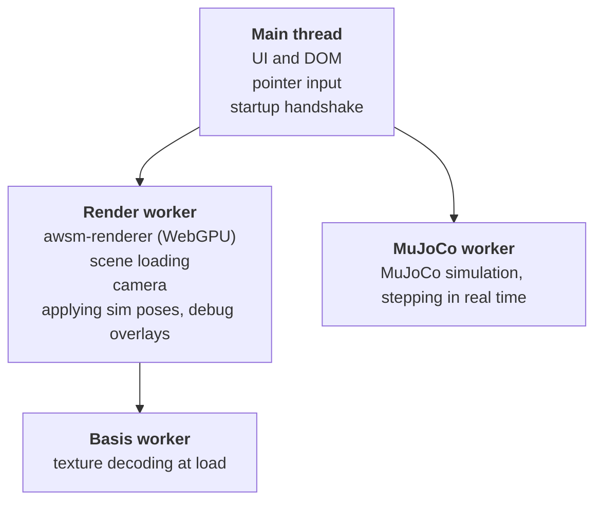
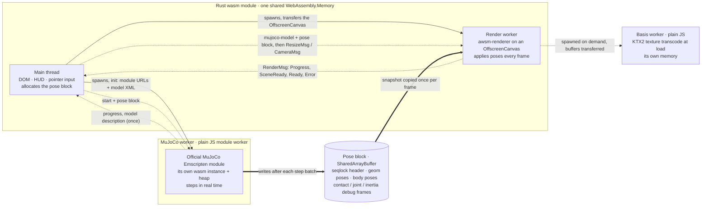

# AWSM Template
## MuJoCo physics — ragdolls and deformables — w/ multithreaded rendering

_Deploys to GitHub Pages on every merge to `main`._

----
A copyable **template** from the [**Awsm**](https://awsm.fun) project: it
*plays* a scene authored in the [scene editor](https://scene.awsm.fun),
rendered with [`awsm-renderer`](https://crates.io/crates/awsm-renderer), and
driven by **[MuJoCo](https://mujoco.org)** — DeepMind's physics engine —
stepping in the browser as the official `@mujoco/mujoco` Emscripten module on
its own worker thread. The renderer, the editor, and the bundle format never
learn what MuJoCo is: the sim publishes plain world poses through shared
memory, and the render thread applies them as ordinary transforms. That "pose
sink" shape is the whole point of the skeleton — any external simulation (a
native process over a WebSocket, a different engine, a replay file) reduces to
the same wire.

Two demo scenes ship: the DeepMind **humanoid ragdoll**, and a MuJoCo
**cloth flag** — a deformable (*flex*) that imports as an ordinary skinned
mesh and waves in the sim's wind with **no vertex data crossing the wire**.

## Threading at a glance

### What runs where



Arrows point from a thread to the threads that work on its behalf.

### In detail

Three threads, **two separate wasm instances**, and exactly one piece of
shared state on the hot path: the pose block. Solid arrows are spawns,
dotted arrows are `postMessage` (startup and input only), thick arrows are
shared-memory reads/writes.



| What | Lives in | Written by | Read by | Synchronization |
|---|---|---|---|---|
| Pose block | a standalone `SharedArrayBuffer`, allocated by main once the model's sizes are known | MuJoCo worker (single writer) | render worker (single reader) | seqlock: writer makes `seq` odd, writes, makes it even; reader retries a torn copy |
| Rust heap | the shared `WebAssembly.Memory` main + render attach to | each thread, its own data | each thread, its own data | no app state crosses through it — it is what lets one wasm module run on both threads |
| MuJoCo model + sim state | the MuJoCo module's private heap | MuJoCo worker | MuJoCo worker | not shared; f64 state is narrowed to f32 at the publish boundary |

After the startup handshake main is out of the loop: poses go MuJoCo worker
→ pose block → render worker with no messages. More in
[The threads](#the-threads) below.

## Run it

```sh
task dev   # trunk serve on http://127.0.0.1:9000 (COOP/COEP enabled)
           # + a side media server on :9001 for editor exports
```

Besides the usual Rust-wasm toolchain (`task`, `trunk`, nightly via
`rust-toolchain.toml`), building needs a **wasm-capable clang** for the
renderer's meshopt C++ decode path: Apple's clang has no wasm backend, so on
macOS `brew install llvm` (the build + Taskfile probe the Homebrew path
automatically, or point `CC_wasm32_unknown_unknown` at one). Linux distro
clang works as-is. MuJoCo itself needs **no toolchain at all** — it ships as a
prebuilt Emscripten module (`web/vendor/mujoco`), its own wasm instance
deliberately not linked into the Rust build.

Open it in a browser with **WebGPU** + **`SharedArrayBuffer`** (recent
Chrome/Edge).

### Scenes

Two, chosen by query string. A scene is a MuJoCo model **and** the player
bundle exported from that same model — mixing them gives an instance whose
geom count disagrees with the sim, so one name picks both (`Scene` in
`protocol.rs`).

| URL | Model | What it shows |
|---|---|---|
| `/` | `media/mujoco/humanoid.xml` | The DeepMind humanoid ragdoll — rigid bodies, and the subject of every debug overlay below. |
| `/?scene=flag` | `media/mujoco/flag.xml` | A **deformable**: MuJoCo cloth (a *flex*) imported as an ordinary skinned mesh and deformed by the body pose channel. |

The flag is the one that proves the deformable path end to end. A flex's 171
cloth vertices each ride their own body, and the sim publishes those body
frames into the same seqlock as the geom poses; the renderer skins to them.
**No vertex data crosses the wire** — 171 body frames per step is the entire
cost of a waving cloth.

Debug overlays are opt-in and stack, e.g. `/?contacts&joints`:

| Param | Overlay |
|---|---|
| `?contacts` | Active contact points, spikes scaled by normal force |
| `?joints` | Hinge/slide joint anchors + axes |
| `?inertia` | Per-body equivalent inertia boxes (what the solver actually sees) |

They live only in this template — the renderer, the editor and the bundle
format never learn what a contact is.

**Controls:** drag orbits the camera, wheel zooms. The sim runs itself — the
humanoid collapses into a heap, the flag flaps forever.

The **Stats** button (bottom left) opens a small panel (top right): the
display's refresh rate (measured on the main thread, since no browser API
reports it), frames per second, **missed frames** (refreshes that showed no new
frame, per second and in total), and the render worker's CPU time per frame.
It is off by default and remembers its state; **Settings** (bottom right) holds
the render resolution. The panel is `packages/frontend/src/stats.rs`.

Other tasks: `task build` (production build into `dist/`), `task check`
(threaded `cargo check`, no serve), `task lint` (clippy), `task fmt` (format),
`task clean`. CI (`.github/workflows/ci.yml`) runs `cargo fmt --check` and
`task lint` on every push and PR; on merge to `main`,
`.github/workflows/deploy.yml` builds and publishes `dist/` to GitHub Pages.

## The threads

A single Rust wasm bundle serves the main and render roles; the active role is
chosen at runtime (the `wasm-bindgen-rayon` spawn pattern —
`packages/frontend/src/lib.rs`). MuJoCo is a **separate wasm instance** with
its own heap.

| Thread | File | Does |
|---|---|---|
| **Main** | `packages/frontend/src/main_thread.rs` | Owns the DOM (Dominator), spawns both workers, brokers the one-time startup handshake, forwards camera input. The Stats panel is `packages/frontend/src/stats.rs`. |
| **Render** | `packages/frontend/src/render_thread.rs` | Hosts `awsm-renderer` on an `OffscreenCanvas`, loads the editor-exported player bundle, applies the sim's poses every frame, draws the debug overlays. |
| **MuJoCo worker** | `web/workers/mujoco-worker.js` | Hosts the official `@mujoco/mujoco` Emscripten module, steps the sim in real time, publishes geom + body world poses (and contact/joint/inertia debug frames) into a `SharedArrayBuffer` pose block. |

Main + render share one `WebAssembly.Memory` — the threaded build profile
(nightly, `+atomics,+bulk-memory`, `-Z build-std`) plus COOP/COEP headers on
serve (`Trunk.toml`) make that possible; see the notes in `Taskfile.yml`. The
MuJoCo module talks only through the pose block: a **seqlock**
(`protocol.rs`) whose writer makes the sequence odd, writes poses, makes it
even — the reader retries on a torn frame instead of blocking. MuJoCo computes
in f64; the worker narrows to f32 at the publish boundary, so the renderer
never meets a double.

## How a scene binds to the sim

1. The **offline exporter** (`awsm-renderer-mujoco-export`, in the renderer
   repo) compiles the MJCF with MuJoCo's own compiler and emits a sidecar
   (`<name>.mujoco.json`) + geometry GLB. Nothing here parses MJCF.
2. The **scene editor** imports that pair: one placeable sim-instance root,
   one node per visible geom (each stamped with its MuJoCo geom id), and each
   flex as a skinned mesh whose joints are the bodies its vertices ride.
3. This template loads the **player bundle** exported from that scene; the
   loader resolves the sim instance (`scene_loader::mujoco::MujocoInstance` —
   geom/body id → transform), and the render thread feeds it every frame:
   `apply_geom_poses` for rigid bodies, `apply_body_poses` for the flex's
   joints. The fingerprint recorded at import (source filename + content
   hash) is checked against the loaded model, so a scene/model mismatch fails
   loudly instead of driving the wrong nodes.

## Swapping in your own scene

1. Run the exporter on your MJCF, import the sidecar into the
   [scene editor](https://scene.awsm.fun), light and dress the scene, and
   export a player bundle.
2. Drop the pieces into `media/` — the model XML under `media/mujoco/`, the
   bundle as `media/bundle/` (`scene.toml` + `assets/`). That layout is
   exactly what gets served: the `copy-dir` links in
   `packages/frontend/index.html` put it in `dist/` same-origin (COEP blocks
   cross-origin fetches), and `task dev`'s side media server serves `media/`
   as-is.
3. Add your scene to the `Scene` enum in `packages/frontend/src/protocol.rs`
   (model + bundle are chosen together, on purpose).

## Dependencies

Physics is the official
**[`@mujoco/mujoco`](https://www.npmjs.com/package/@mujoco/mujoco)**
Emscripten build (Apache-2.0), vendored prebuilt at `web/vendor/mujoco` — no
C/C++ toolchain, no submodule, its own wasm module and heap. The Basis texture
transcoder rides the same pattern at `web/vendor/basis`.

The Rust side is the **`awsm-renderer`** family (renderer, scene loader,
meshgen) plus `dominator` / `futures-signals` and `glam 0.32`. During
development the renderer crates are **path-dependencies on a sibling checkout**
of the renderer repo (see `Cargo.toml`); a released cut of this template pins
them to the published crates.io versions instead.
