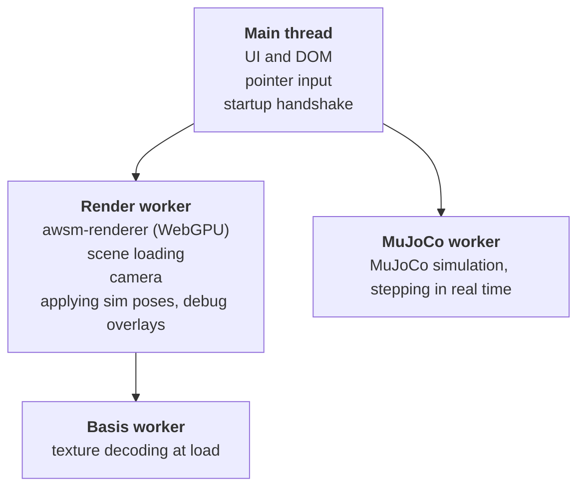
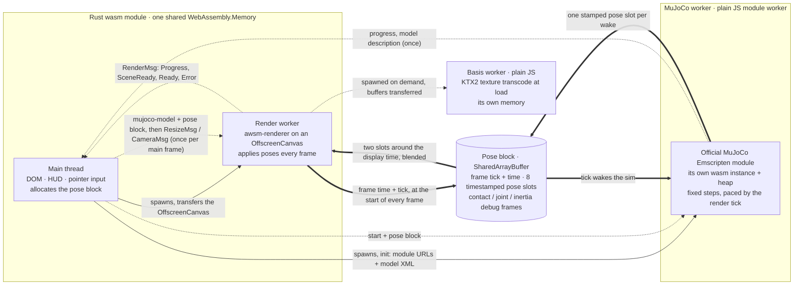

# AWSM Template
## MuJoCo physics — ragdolls and deformables — w/ multithreaded rendering

_Deploys to GitHub Pages on every merge to `main`._

----
A copyable **template** from the [**Awsm**](https://awsm.fun) project: it
*plays* a scene authored in the [scene editor](https://scene.awsm.fun),
rendered with [`awsm-renderer`](https://crates.io/crates/awsm-renderer), and
driven by **[MuJoCo](https://mujoco.org)** — DeepMind's physics engine —
stepping in the browser as the official `@mujoco/mujoco` Emscripten module on
its own worker thread. The renderer, the editor, and the bundle format never
learn what MuJoCo is: the sim publishes plain world poses through shared
memory, and the render thread applies them as ordinary transforms. That "pose
sink" shape is the whole point of the skeleton — any external simulation (a
native process over a WebSocket, a different engine, a replay file) reduces to
the same wire.

Two demo scenes ship: the DeepMind **humanoid ragdoll**, and a MuJoCo
**cloth flag** — a deformable (*flex*) that imports as an ordinary skinned
mesh and waves in the sim's wind with **no vertex data crossing the wire**.

## Threading at a glance

### What runs where



Arrows point from a thread to the threads that work on its behalf.

### In detail

Three threads, **two separate wasm instances**, and exactly one piece of
shared state on the hot path: the pose block. Solid arrows are spawns,
dotted arrows are `postMessage` (startup and input only), thick arrows are
shared-memory reads/writes.



| What | Lives in | Written by | Read by | Synchronization |
|---|---|---|---|---|
| Pose block | a standalone `SharedArrayBuffer`, allocated by main once the model's sizes are known | render worker: frame time + tick; MuJoCo worker: pose slots + debug frames | each the other's | the tick is `Atomics.notify`'d and awaited with `Atomics.waitAsync`; each pose slot has its own seq (odd while written), and the reader re-checks it after copying and falls back to an older pair, never waiting |
| Rust heap | the shared `WebAssembly.Memory` main + render attach to | each thread, its own data | each thread, its own data | no app state crosses through it — it is what lets one wasm module run on both threads |
| MuJoCo model + sim state | the MuJoCo module's private heap | MuJoCo worker | MuJoCo worker | not shared; f64 state is narrowed to f32 at the publish boundary |

After the startup handshake main is out of the loop: poses go MuJoCo worker
→ pose block → render worker with no messages. More in
[The threads](#the-threads) and [Timing](#timing) below.

## Run it

```sh
task dev   # trunk serve on http://127.0.0.1:9000 (COOP/COEP enabled)
           # + a side media server on :9001 for editor exports
```

Besides the usual Rust-wasm toolchain (`task`, `trunk`, nightly via
`rust-toolchain.toml`), building needs a **wasm-capable clang** for the
renderer's meshopt C++ decode path: Apple's clang has no wasm backend, so on
macOS `brew install llvm` (the build + Taskfile probe the Homebrew path
automatically, or point `CC_wasm32_unknown_unknown` at one). Linux distro
clang works as-is. MuJoCo itself needs **no toolchain at all** — it ships as a
prebuilt Emscripten module (`web/vendor/mujoco`), its own wasm instance
deliberately not linked into the Rust build.

Open it in a browser with **WebGPU** + **`SharedArrayBuffer`** (recent
Chrome/Edge).

### Scenes

Two, chosen by query string. A scene is a MuJoCo model **and** the player
bundle exported from that same model — mixing them gives an instance whose
geom count disagrees with the sim, so one name picks both (`Scene` in
`protocol.rs`).

| URL | Model | What it shows |
|---|---|---|
| `/` | `media/mujoco/humanoid.xml` | The DeepMind humanoid ragdoll — rigid bodies, and the subject of every debug overlay below. |
| `/?scene=flag` | `media/mujoco/flag.xml` | A **deformable**: MuJoCo cloth (a *flex*) imported as an ordinary skinned mesh and deformed by the body pose channel. |

The flag is the one that proves the deformable path end to end. A flex's 171
cloth vertices each ride their own body, and the sim publishes those body
frames into the same pose slot as the geom poses; the renderer skins to them.
**No vertex data crosses the wire** — 171 body frames per step is the entire
cost of a waving cloth.

Debug overlays are opt-in and stack, e.g. `/?contacts&joints`:

| Param | Overlay |
|---|---|
| `?contacts` | Active contact points, spikes scaled by normal force |
| `?joints` | Hinge/slide joint anchors + axes |
| `?inertia` | Per-body equivalent inertia boxes (what the solver actually sees) |

They live only in this template — the renderer, the editor and the bundle
format never learn what a contact is.

**Controls:** drag orbits the camera, wheel zooms. The sim runs itself — the
humanoid collapses into a heap, the flag flaps forever.

The **Stats** button (bottom left) opens a small panel (top right) with one
group per thread, each number under the thread that spent it, with its unit
and what it is per:

| Group | Headline | Rows when expanded |
|---|---|---|
| `frame budget` | the refresh period and the headroom left by the largest lane (`16.7 ms (60 Hz) · headroom 9.5 ms`, or `over by …` in red) | one row per lane, `used / budget ms (n%)`: `GPU`, `renderer (render worker)`, `sim (MuJoCo, worker)` (its time per step × steps per frame), `page (main thread)`; then `latency (renderer + GPU), reference only` |
| `display` | refresh rate · fps | refresh rate (measured on the main thread, since no browser API reports it), frames presented, **missed frames** (refreshes that showed no new frame) |
| `GPU` | GPU time per frame (timestamp queries; `n/a` without them) | one row per pass, slowest first; on GPUs that overlap passes (Apple's) they add up to more than the frame |
| `renderer (render worker)` | the render worker's CPU time per frame | its five phases (`animations + particles`, `read app state + interpolate`, `set camera`, `update transforms`, `render (encode + submit)`); under render, awsm-renderer's own CPU scopes as `prepare` (uploads, bind groups, …), `passes` and `submit`, each scope slowest first (those under 1 µs folded into one row), then `outside the scopes` |
| `sim (MuJoCo, worker)` | the MuJoCo worker's CPU time per step | steps/s, **late frames** (frames that found MuJoCo had not yet finished the state they were due to show, and held the newest one; see [Timing](#timing)), stepping (`mj_step`) vs publishing |
| `page (main thread)` | the main thread's own work per frame | `camera frame loop` |

Click a group to expand it; each remembers its state. Expanding a group is
what turns on its extra timing (the renderer's CPU scopes and phase clocks, the
per-pass GPU numbers, the sim's split), so a collapsed group, or a hidden
panel, costs nothing; an expanded one is timed on every frame. CPU and GPU work
run in parallel, so each must fit the budget on its own; they do not add up,
except when the CPU waits on the GPU, which shows as missed frames. Late frames
that keep happening turn the sim group red. The panel is off by default and
remembers its state.
**Settings** (bottom right) holds the render resolution and the
anti-aliasing: Off, SMAA, MSAA 4×, TAA, or TAA upscaling from 67%, 58% or 50%
of the resolution (Quality, Balanced, Performance). TAA is the default on a
desktop; a touch device or a software GPU starts with it off (and a lower
resolution). `?aa=<mode>` (`off`, `smaa`, `msaa`, `taa`, `taa-quality`,
`taa-balanced`, `taa-performance`) picks one for a single visit without
storing it, and `?reset` forgets every stored setting. **About** (bottom
centre) says what the demo is and, on its Stats tab, what every number in the
panel means (the panel's `what do these mean?` opens it there).

Settings and Stats come from
[awsm-renderer-kit](https://github.com/awsm-fun/awsm-renderer-kit), shared by
every awsm-renderer template: its `SettingsPanel` and `StatsPanel` on the
main thread, and its stats collector and anti-aliasing switch in the render
worker. What is this app's own is in `packages/frontend/src/stats.rs` (the
frame phases and the sim group) and `packages/frontend/src/main_thread.rs`
(where the panels mount, and the words); the About modal is
`packages/frontend/src/about.rs`.

Other tasks: `task build` (production build into `dist/`), `task check`
(threaded `cargo check`, no serve), `task lint` (clippy), `task fmt` (format),
`task clean`. CI (`.github/workflows/ci.yml`) runs `cargo fmt --check` and
`task lint` on every push and PR; on merge to `main`,
`.github/workflows/deploy.yml` builds and publishes `dist/` to GitHub Pages.

## The threads

A single Rust wasm bundle serves the main and render roles; the active role is
chosen at runtime (the `wasm-bindgen-rayon` spawn pattern —
`packages/frontend/src/lib.rs`). MuJoCo is a **separate wasm instance** with
its own heap.

| Thread | File | Does |
|---|---|---|
| **Main** | `packages/frontend/src/main_thread.rs` | Owns the DOM (Dominator), spawns both workers, brokers the one-time startup handshake, owns the orbit camera's state and posts it once per frame. The Settings and Stats panels are awsm-renderer-kit's; the app's stats group is `packages/frontend/src/stats.rs`. |
| **Render** | `packages/frontend/src/render_thread.rs` | Hosts `awsm-renderer` on an `OffscreenCanvas`, loads the editor-exported player bundle, ticks the sim at the start of every frame, advances the scene's clips, texture flows and particles (`update_animations`, `ParticleDriver`), then draws the sim's poses blended at the display time (after the clips, so the sim wins) and the debug overlays. |
| **MuJoCo worker** | `web/workers/mujoco-worker.js` | Hosts the official `@mujoco/mujoco` Emscripten module, steps the sim at its fixed timestep as the render tick pays for (or on its own clock when no renderer is ticking), publishes timestamped geom + body world poses (and contact/joint/inertia debug frames) into a `SharedArrayBuffer` pose block. |

Main + render share one `WebAssembly.Memory` — the threaded build profile
(nightly, `+atomics,+bulk-memory`, `-Z build-std`) plus COOP/COEP headers on
serve (`Trunk.toml`) make that possible; see the notes in `Taskfile.yml`. The
MuJoCo module talks only through the pose block (`protocol.rs`). MuJoCo
computes in f64; the worker narrows to f32 at the publish boundary, so the
renderer never meets a double.

## Timing

The sim plays every step at MuJoCo's fixed timestep, as many per wake as real
time has paid for; the display only ever shows the latest state or a blend of
the latest two (Glenn Fiedler's "Fix Your Timestep"). Sim and renderer run on
different threads, so one clock ties them together: the render worker's frame
times. All times are absolute (`performance.timeOrigin + now`), which every
worker of the page agrees on.

1. At the **start** of each frame the render worker writes its rAF time `T` to
   the pose block and bumps a tick.
2. The MuJoCo worker, waiting on that tick (`Atomics.waitAsync`), adds the
   time since it last stepped to its accumulator, runs whole steps while the
   accumulator holds one, and publishes one pose slot stamped
   `T - accumulator`: the time its state is due.
3. The next frame draws at `T - dt` for the previous frame's `T`, blending the
   two slots on either side (positions lerped, rotations nlerped). That is
   `lerp(latest-1, latest, accumulator / dt)`: uniform motion at any refresh
   rate, one frame plus at most one step behind.

If MuJoCo has not finished by the next frame, that frame holds the newest pose
and the Stats panel counts it as a **late frame** (sim group): the humanoid (5 ms steps, three
or four per frame at 60 Hz) never is; the flag's cloth, at 2 ms steps (about
eight per frame) of a costly flex, takes 11–13 ms of each 16.7 ms frame and is
occasionally late. With no tick for 100 ms (no renderer yet, a hidden tab) the
sim keeps going on its own clock, on the same timeline, so a robotics run never
stalls.

The camera follows the same "one frame of input per drawn frame" rule: main
owns its state (pointer events update it), posts it once per main-thread frame
in which it changed, stamped with that frame's time, and the render worker
draws the newest state at least half a frame older than its own frame. Each
frame therefore shows exactly one main frame's worth of dragging, however the
two threads' callbacks interleave, with one frame of latency.

## How a scene binds to the sim

1. The **offline exporter** (`awsm-renderer-mujoco-export`, in the renderer
   repo) compiles the MJCF with MuJoCo's own compiler and emits a sidecar
   (`<name>.mujoco.json`) + geometry GLB. Nothing here parses MJCF.
2. The **scene editor** imports that pair: one placeable sim-instance root,
   one node per visible geom (each stamped with its MuJoCo geom id), and each
   flex as a skinned mesh whose joints are the bodies its vertices ride.
3. This template loads the **player bundle** exported from that scene; the
   loader resolves the sim instance (`scene_loader::mujoco::MujocoInstance` —
   geom/body id → transform), and the render thread feeds it every frame:
   `apply_geom_poses` for rigid bodies, `apply_body_poses` for the flex's
   joints. The fingerprint recorded at import (source filename + content
   hash) is checked against the loaded model, so a scene/model mismatch fails
   loudly instead of driving the wrong nodes.

## Swapping in your own scene

1. Run the exporter on your MJCF, import the sidecar into the
   [scene editor](https://scene.awsm.fun), light and dress the scene, and
   export a player bundle. The rest of the scene plays as authored: clips,
   texture flows and particles run, and the sim's poses override any clip on
   its geoms. Anti-aliasing is the template's (`ANTI_ALIASING` in
   `packages/frontend/src/render_thread.rs`), not the bundle's.
2. Drop the pieces into `media/` — the model XML under `media/mujoco/`, the
   bundle as `media/bundle/` (`scene.toml` + `assets/`). That layout is
   exactly what gets served: the `copy-dir` links in
   `packages/frontend/index.html` put it in `dist/` same-origin (COEP blocks
   cross-origin fetches), and `task dev`'s side media server serves `media/`
   as-is.
3. Add your scene to the `Scene` enum in `packages/frontend/src/protocol.rs`
   (model + bundle are chosen together, on purpose).

## Dependencies

Physics is the official
**[`@mujoco/mujoco`](https://www.npmjs.com/package/@mujoco/mujoco)**
Emscripten build (Apache-2.0), vendored prebuilt at `web/vendor/mujoco` — no
C/C++ toolchain, no submodule, its own wasm module and heap. The Basis texture
transcoder rides the same pattern at `web/vendor/basis`.

The Rust side is the **`awsm-renderer`** family (renderer, scene loader,
meshgen) plus `dominator` / `futures-signals` and `glam 0.32`. During
development the renderer crates are **path-dependencies on a sibling checkout**
of the renderer repo (see `Cargo.toml`); a released cut of this template pins
them to the published crates.io versions instead.
